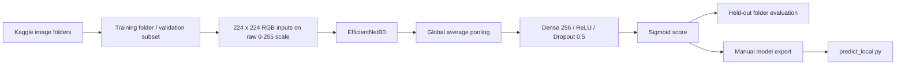
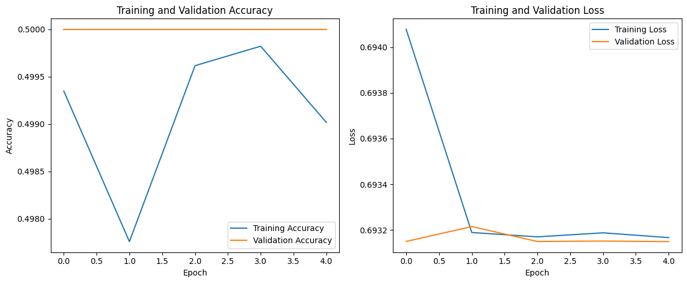
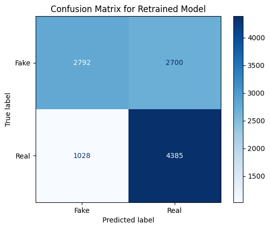

# Deepfake image-classification experiment

A TensorFlow/Keras learning project using an ImageNet-pretrained EfficientNetB0 backbone for binary image classification. The repository contains a training/fine-tuning notebook and an interactive local prediction script. It does not establish state-of-the-art performance or reliable image authenticity assessment.

## Pipeline



EfficientNet's preprocessing is kept inside the model; the directory generators do not apply an additional `1/255` rescale. The first stage freezes the backbone for 5 epochs. A second stage unfreezes later layers and fits for 10 epochs. These are configured epochs, not reproduced runtimes or guaranteed outcomes.

## Committed experiment visuals

These two figures were extracted byte-for-byte from the existing outputs in `DFDM_fixed.ipynb`, not regenerated during this audit. They are historical notebook artifacts and may not reflect a fresh execution of the current preprocessing code. No new training result or benchmark is claimed.



The committed first-stage validation curve is around chance level. It is evidence of an experimental run requiring investigation, not evidence of a high-accuracy detector.



The committed matrix includes both false-positive and false-negative predictions. Test provenance, identity separation, calibration and reproducibility were not independently established. No face or patient image was copied into this README.

## Set up a training environment

Use an isolated Python version supported by the TensorFlow release you install. The dependency manifest is unpinned and has not been verified as a locked environment.

```powershell
python -m venv .venv
# Activate the virtual environment for your shell.
python -m pip install -r requirements.txt
```

Open `DFDM_fixed.ipynb` in an existing Jupyter/VS Code environment or Google Colab. It downloads the `manjilkarki/deepfake-and-real-images` dataset through KaggleHub and expects `Dataset/Train` and `Dataset/Test` folders. Review the dataset's current access and licensing terms before downloading or redistributing it. Dataset download and full training were not run in the audit.

`LAPTOP_MODE` is a reserved, unused flag. Setting it to true does not shrink data, cap epochs, save a model, or provide a timed CPU mode. Reduce the actual generator/fit settings deliberately for a smoke experiment; no under-three-minute or under-one-hour claim is verified.

## Export and run the local predictor

After training and checking the notebook's `train_data.class_indices`, manually export its model:

```python
model.save('deepfake_detector.h5')
```

This export was not executed during the audit. No trained model is committed.

The script searches the current user's `Downloads` folder for `deepfake_detector.h5`, then the current working directory. It now uses the active user's home path rather than one hardcoded Windows account. Put the file in the working directory if your system uses a different downloads-folder location.

```powershell
python predict_local.py path/to/image.jpg
```

Without an image argument it prompts for a path. It loads a trusted exported model, reads the image with OpenCV, converts BGR to RGB, resizes to 224 x 224, predicts and displays the image. Its class labels assume the notebook's `Fake=0`, `Real=1` mapping. The displayed percentages are uncalibrated classifier scores, not a measured probability that an arbitrary image is authentic.

## Offline verification

```powershell
python -m unittest discover -s tests -v
```

Two model-discovery tests pass on Python 3.10. They exercise the real script using temporary folders and fake external-library/model-loading boundaries, without loading or deserializing a model. The current-user Downloads test failed before the path correction; the working-directory fallback remained passing. All 22 Python notebook cells parse after excluding the notebook installation command.

These checks establish portable model-file discovery and syntax only. TensorFlow installation, dataset loading, training, model export and real inference were not executed.

## Research limits and next work

- Record dataset versions, class mappings, dependency versions, seeds and checkpoint provenance.
- Check for duplicate images and identity/video overlap across splits before interpreting held-out scores.
- Add reproducible preprocessing and inference regressions using small licensed fixtures.
- Evaluate calibration, class-specific errors and out-of-distribution images before making confidence claims.
- Add explicit CLI failure exit codes and configurable model paths if the script becomes a maintained tool; current failures are printed and are not a robust automation interface.

The project is retained for applied-ML learning. No repository-wide license is declared; dataset and pretrained-model terms are separate.
